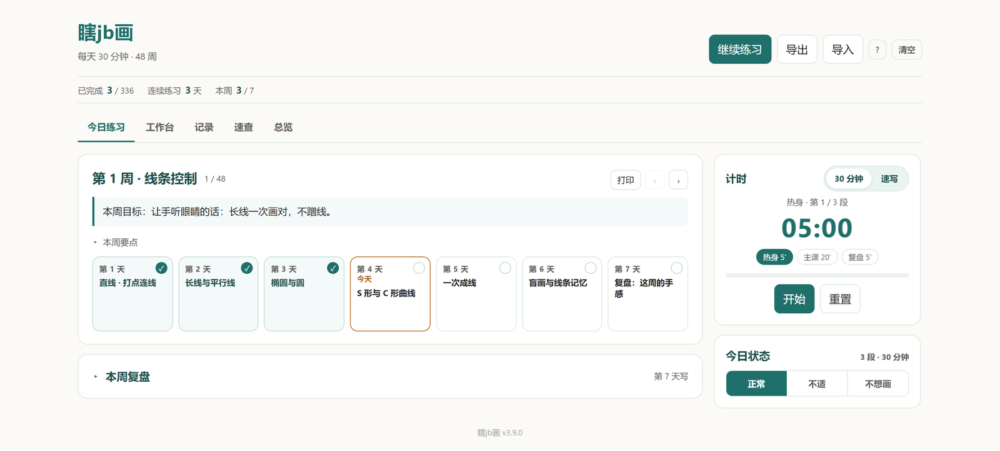
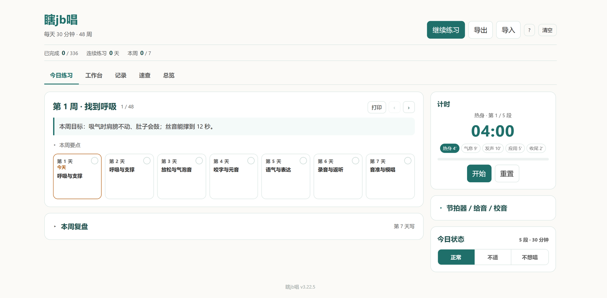
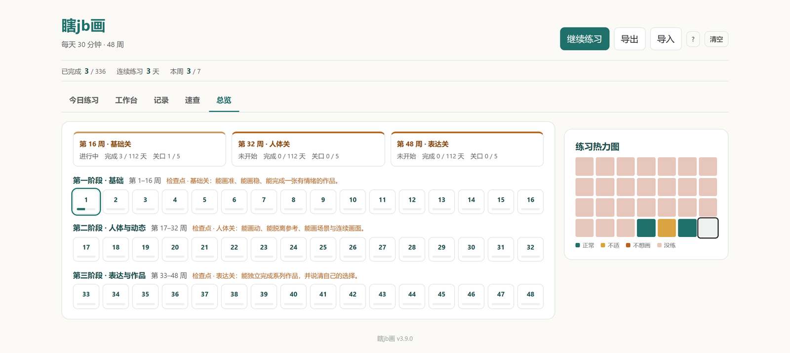
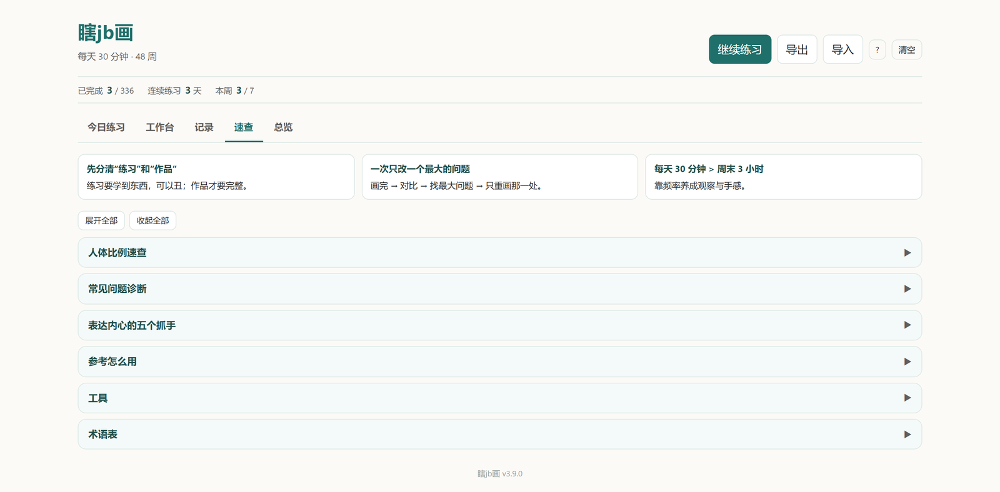

# xiajb — two 48-week practice trackers

**48 weeks × 30 minutes a day. No account, no install, no server — just open the file and practice.**

Two single-file web apps for absolute beginners:

- **Draw** — figure drawing, 336 days: line, structure, anatomy, expression, scenes.
- **Sing** — singing, 336 days: breath, tone, pitch, diction, expression, with recording.

[中文](README.md) | **English**

  
  

| App | Open in browser |
| --- | --- |
| Draw (瞎jb画) | **[draw.html](https://qxs9678.github.io/0033/draw.html)** |
| Sing (瞎jb唱) | **[sing.html](https://qxs9678.github.io/0033/sing.html)** |

## How it works

Most beginners don't lack tutorials — they lack an answer to "what do I practice today, for how long, and when am I done?" Both apps slice 336 days into weeks of seven 30-minute sessions: warm-up → main practice → reflection. One task per day, tick it off, the progress bar moves.

- 30 minutes a day, built-in timer (plus a quick-sketch and metronome mode).
- 48 weeks in three phases (fundamentals → body/voice → expression); every fourth week is a "delivery day".
- Draw includes a reference breakdown board (grid, grayscale, values, flip, zoom).
- Data lives only in your browser: `localStorage` + `IndexedDB`. Exporting a JSON file is the whole backup.

## Notes

- Both pages are plain HTML with everything inlined — no dependencies, works offline.
- The interface is Chinese; the art reference search terms are English.
- Opening the file locally (`file://`) and from GitHub Pages are two separate data stores — pick one and stay there, or export and import.
- Microphone features (recording, pitch check) need HTTPS, which GitHub Pages provides.

  
  

## License

[MIT](LICENSE)
