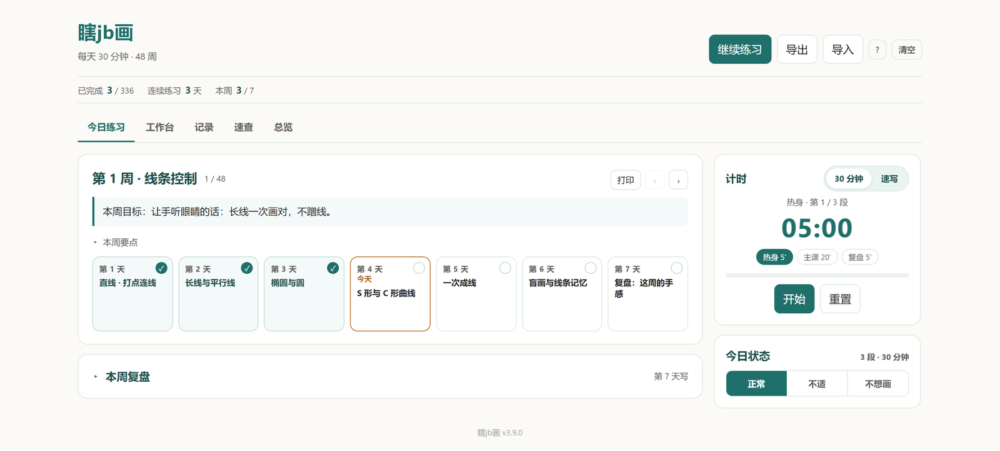
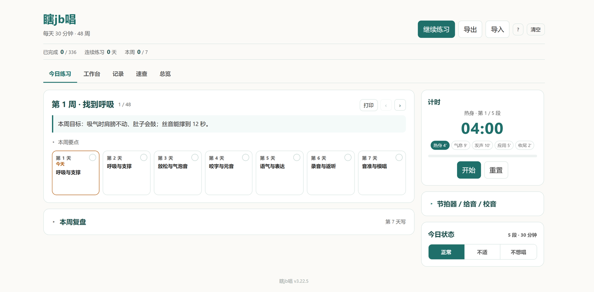
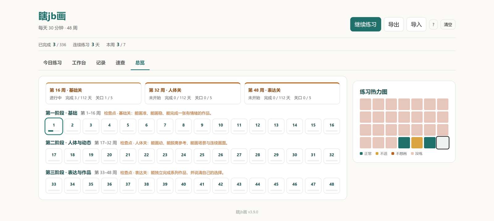
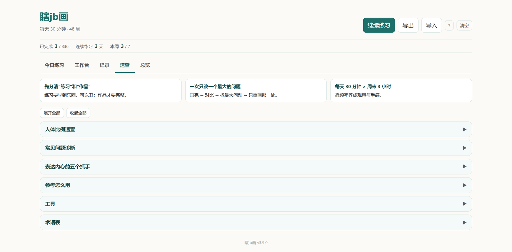

# 瞎jb系列 · 两个 48 周训练器

**48 周 × 每天 30 分钟，零基础。** 两个单文件网页：**瞎jb画**（人物画）和**瞎jb唱**（唱歌）。打开就用，不注册、不安装、断网也能练，记录只在你自己的浏览器里。

**中文** | [English](README.en.md)

  
  

| 应用 | 练什么 | 直接打开 |
| --- | --- | --- |
| **瞎jb画** | 48 周人物画：线条、结构、人体、表情、场景，最后能画一张有情绪的画 | **[draw.html](https://qxs9678.github.io/0033/draw.html)** |
| **瞎jb唱** | 48 周唱歌：呼吸、发声、音准、咬字、表达，录音回听 | **[sing.html](https://qxs9678.github.io/0033/sing.html)** |

## 它解决什么问题

零基础的人不缺教程，缺的是「今天练什么、练多久、练完算不算过」。两个应用把 336 天切成每周 7 天、每天 30 分钟（5′ 热身 + 20′ 主课 + 5′ 复盘），每 4 周一个交付日。

- **每天只有一件事**：照着当天的参考练，做完打勾，进度自己往前走。
- **画**：参考拆解台（叠加、三分线、灰度、翻转）、速查手册。**唱**：节拍器、校音、录音回听。
- **作品墙**只存 12 个交付日的照片，不逼你天天拍。
- **数据只在本地**：`localStorage` + `IndexedDB`，导出一个 JSON 就是全部备份。

  
  

## 怎么开始

1. 打开 [draw.html](https://qxs9678.github.io/0033/draw.html) 或 [sing.html](https://qxs9678.github.io/0033/sing.html)。
2. 点「开始」，跟着当天的参考做 30 分钟。
3. 做完打勾；每周第 7 天写复盘。
4. 手机浏览器「添加到主屏幕」，当 App 用。

> 想完全离线：把 `draw.html` / `sing.html` 下载下来双击。`file://` 和 `https://` 是两份数据，选定一个别换；录音和校音需要 HTTPS。

## 数据

两个应用格式不同，不能互相导入。迁移只有一招：旧地址「导出」→ 新地址「导入」。

- **画**：`drawplan:*` + `drawplan-works`（作品 JPEG）
- **唱**：`singplan48:*` + `takes`（录音）

浏览器按网址隔离数据：换域名、换入口，旧记录不会自动出现；同一域名下换路径不算换源。所以确定一个入口后就一直用它，并定期导出。

## 源码

成品由 Python 脚本生成，仓库只放构建后的单文件；模板、课程数据和构建脚本不发布。

## 说明

- 唱歌的曲目不内置歌词（版权），由使用者自行粘贴。
- 画的参考搜索词是英文，需要联网；页面本身离线可用。
- 更新记录见 [CHANGELOG.md](CHANGELOG.md)。

## License

[PolyForm Noncommercial 1.0.0](LICENSE) · 个人、学习、非营利免费，商用需单独授权。
